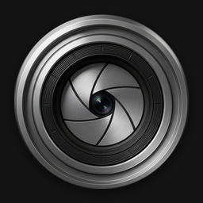
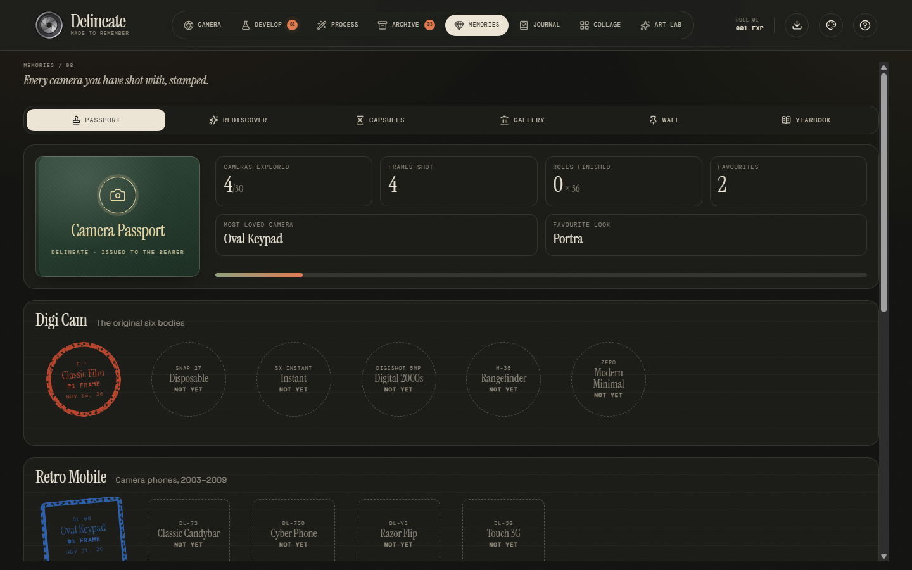
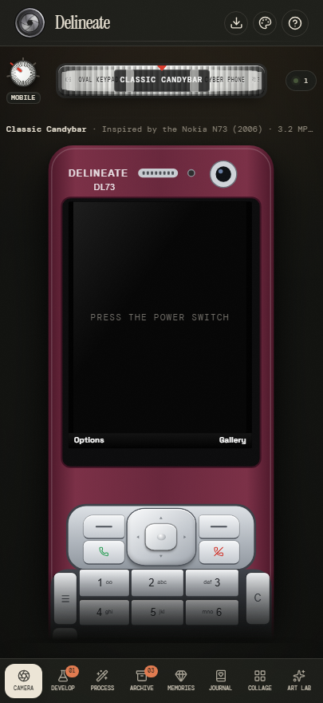
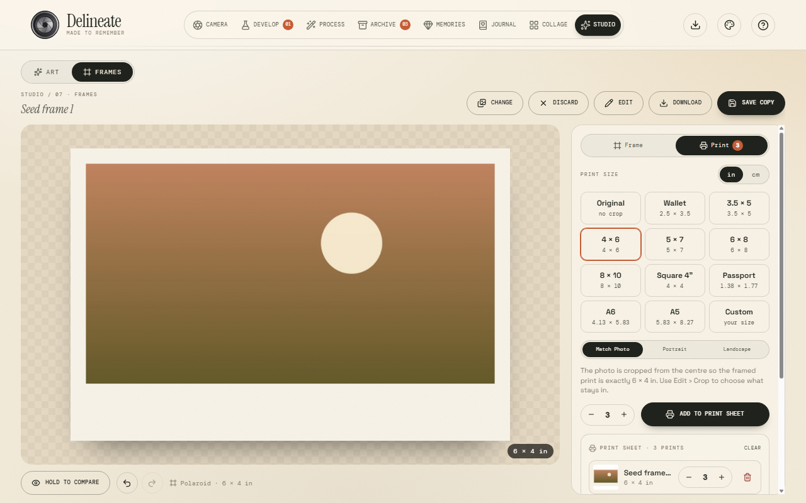
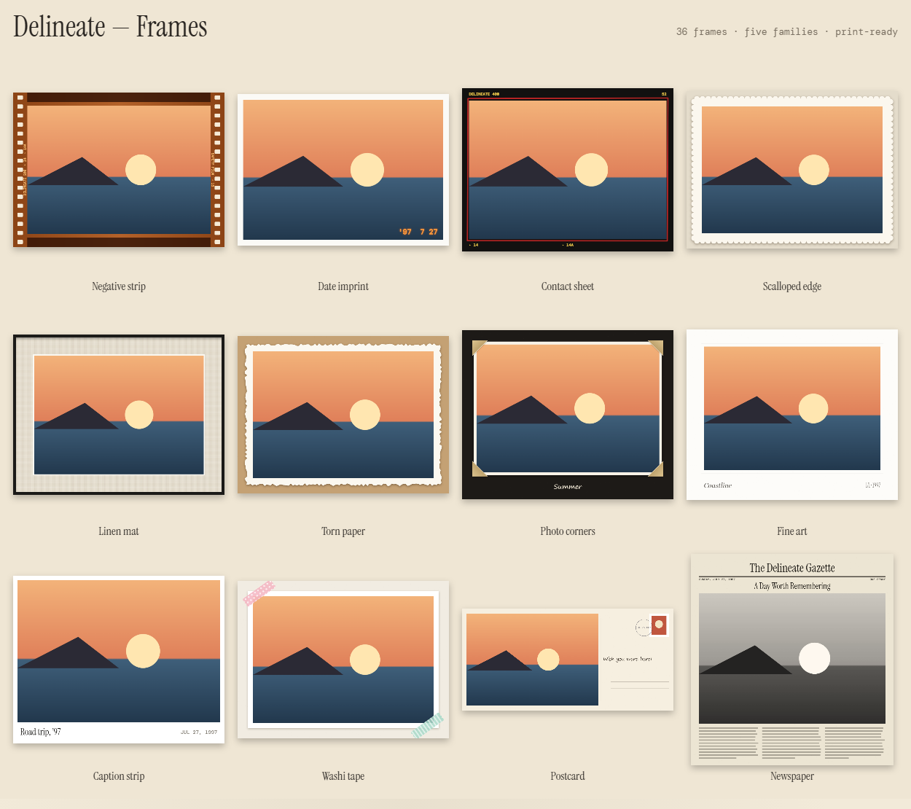
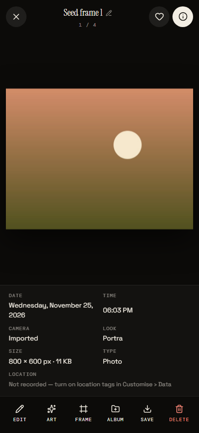

<p align="center">
  
</p>

<h1 align="center">Delineate</h1>
<p align="center"><em>Made to Remember.</em></p>

<p align="center">
  A film camera, darkroom, photo lab, scrapbook journal and collage studio — all in the browser.<br />
  Private by default, installable, and it works offline.
</p>


## What it does

| Tab | What you get |
| --- | --- |
| **Camera** | A physical-feeling camera with six bodies (Classic Film, Disposable, Instant, Digital 2000s, Rangefinder, Modern Minimal), each with its own layout, shutter animation, sounds and haptics. Real rotary knobs for ISO, shutter, aperture, EV, white balance and timer; auto / manual mode; zoom; grid; aspect ratios; front/back camera. Real long exposures and Bulb mode (averaged or light-trail), in-camera double/triple exposure, and the phone's LED flash where the browser supports it. |
| **Develop** | Every shot lands on the roll as a negative. Print it by hand in a first-person darkroom: expose under the enlarger, rock the developer, stop, fix, wash and hang it to dry — and get graded. Or let the one-hour lab skip it. |
| **Process** | Film, vintage, digital, nostalgia, editorial, cinematic and experimental presets (Portra, CineStill, VHS, CCD, Infrared, CRT…) plus 25+ effects: halation, mist, starburst, lens flare, light leaks, motion trails, cross-processing, bleach bypass, solarization, thermal, MiniDV, CRT, anamorphic, gate weave, date stamps, double exposure, film borders and 2×2 photo-booth strips. Settings are saved, so frames can be re-edited later. |
| **Archive** | Private storage with favourites, search, filters and six display modes (grid, compact, large, contact sheet, polaroid wall, list). Download one frame or the whole roll as a ZIP. |
| **Journal** | Scrapbook books with themed pages, photos, text, freehand doodles and 80+ decorations, ready-made page layouts, zoom and pinch, undo — exported as a PDF. |
| **Collage** | 13 layouts and 6 styles with adjustable spacing, margins, corners, borders, shadows and captions. |
| **Art Lab** | Turn a print into pixel art, abstract swirls, geometric facets or a looping GIF, with picture frames. |

Everything is customisable: five themes (Light, Dark, Vintage, Pastel, Darkroom), an accent colour, and three control styles — modern sliders, vintage tactile faders or rotary knobs.

## Privacy

Photos and journals are stored only in your browser (IndexedDB). Nothing is uploaded. Clearing site data erases the archive, so download anything you want to keep.

## Run it locally

Requires Node.js 20.19+ or 22.12+.

```bash
npm install
npm run dev       # development server
npm run build     # production build into dist/
npm run preview   # serve the production build
```

The camera needs a secure context: `localhost` works, anything else needs HTTPS.

## Deploy

`npm run build` produces a static site in `dist/`. Host it at the root of any HTTPS domain — for example drag `dist/` onto [Netlify Drop](https://app.netlify.com/drop), or import the repo into Vercel or Cloudflare Pages with build command `npm run build` and output directory `dist`.

After the first visit the app works offline, and phones can install it from the browser menu ("Add to Home screen" / "Install app").

## Tech

React 19, TypeScript and Vite. All image processing runs on the HTML canvas; no image or PDF libraries. `gifenc` encodes animated GIFs and `jszip` packs archive exports.

```
src/
  components/   one view per tab, plus shared UI (knobs, pickers, modals)
  lib/          rendering pipeline, effects, frames, PDF writer, storage, audio
  styles/       global theme and per-section styles
public/         icons, web manifest and the offline service worker
```

A small self-check for the PDF writer: `node scripts/pdf.check.ts` (Node 22.6+).

---

## What's new (1.1 – 1.3)


### Camera collection

The camera is now a collection of **30 bodies in five collections**, picked with a knurled rotary dial and the body wheel. Every body has its own layout, its own button and shutter sounds, and its own look that shows live in the viewfinder and is baked into the photo.

| Collection | Bodies (inspired by) |
| --- | --- |
| **Digi Cam** | The original six bodies |
| **Retro Mobile** | Nokia 6600, Nokia N73, Sony Ericsson K750i/W810i, Motorola RAZR V3 (drawn keypad phones, held sideways on wide screens) and iPhone 3GS |
| **Pocket Digital** | Canon IXUS, Sony Cyber-shot, Fujifilm FinePix, Nikon Coolpix, Casio Exilim, Olympus µ, Panasonic Lumix, Kodak EasyShare — each with its own button layout |
| **Film & Instant** | Instax Mini and Polaroid SX-70 (framed prints), Kodak FunSaver, Olympus Mju II, Diana F, Leica M6 — wind-on film where the real camera had it |
| **Experimental** | VHS and MiniDV camcorders (tape transport, timestamps), a four-shade pixel camera, an early desktop webcam, a panoramic film camera |

Playback on every body browses the whole gallery (W/T, arrows, tape rewind/fast-forward or a swipe), and each body has an on-screen settings menu. In **Process**, *Strip cam FX* removes a body's built-in look to edit the clean capture.

### Develop: advanced darkroom

Next to the hands-on darkroom there is an **Advanced** mode: exposure, highlights, shadows, whites, blacks, temperature, tint, vibrance, HSL, tone curves, split toning, bloom and halation — with undo/redo, before/after split, hold-to-compare, copy/paste of chosen adjustments and a **Recipe Lab** (starter looks, rename, duplicate, reorder, favourite, import/export as JSON). Edits are non-destructive: originals and edit settings are stored side by side.

### Memories



A new **Memories** tab gathers the signature experiences:

- **Passport** — a stamp for every camera you have shot with; tap one to pick that camera up again.
- **Rediscover** — opt-in *Forgotten Frames*: a random handful of five older, unfavourited photos each day (keep close, add to an album, or not now), plus *On This Day*. Nothing is ever deleted or uploaded.
- **Capsules** — seal photos and a note until a date you choose.
- **Gallery** — favourites, albums and each year hung on a lit gallery wall, with a slideshow.
- **Wall** — pin photos, notes, dates and ticket stubs on cork, linen, slate or paper; save the board as an image.
- **Yearbook** — a year of photos laid out by month, previewed and exported as a PDF.


### Archive, data and settings

- **Albums** in the Archive — add any frame to one or more albums.
- **Customise → Data** — see what is stored and how much space it uses, protect storage from being cleared, and download a full **backup (.zip)** that restores on any device. Restores are checked first and never delete anything.
- Customise has tabs (Look, Controls, Sound, Comfort, Data, What's new), more themes, button sound packs and clicky tactile sliders.
- Crop, straighten, highlights/shadows, sharpen, dust and scratches, saved presets, more frames and date stamps, journal cover photos and styles, and collage stickers, text and freely placed frames.

<p align="center">
  
</p>

---

## What's new (1.4)

### Studio: frames made for print



The Art Lab is now the **Studio**, with **Art** and **Frames** side by side. Frames is built around the physical print:

- **Print sizes** — Wallet, 3.5×5, 4×6, 5×7, 6×8, 8×10, Square, Passport, A6, A5, or a custom width × height in **inches or cm**. The photo is cropped so the *framed* print comes out exactly that size, at 300 dpi.
- **Print sheet** — add prints of different photos and sizes, set copies, choose the paper (A4, US Letter, A3, 4×6 or 5×7 photo paper), margins, gaps and cut marks, and download **one PDF that prints at true size** (print at 100% / actual size).
- **Edit** opens the full Process editor inside the Frames tab; save or discard to come back to the print. Originals are never changed, and every framed copy re-opens in Process.
- Frame a photo straight from the photo viewer, or a collage right after saving it.

### 36 frames



Five families — **Film, Prints, Gallery, Scrapbook, Experimental** — including Negative strip, Date imprint, Transparency, 120 film, Contact sheet, Scalloped edge, Handmade paper, Linen mat, Torn paper, Photo corners, Embossed, Fine art, Caption strip, Hairline, Double line, Asymmetric, Soft corner, Washi tape, Washi paper, Postcard, Photo booth, Passport, VHS overlay and Newspaper.

- Write your own **caption, headline, message, title or name** where the frame has room for one.
- Adjust **thickness** and **paper colour**, star **favourite frames**, and save **frame recipes** to reuse.
- The same frames are in **Process** and **Studio › Art**, and Process now has **undo/redo** (Ctrl Z / Ctrl Shift Z) and a **resizable crop grid** with a Free shape.

### Archive and photo viewer

<p align="center">
  
</p>

- Smaller thumbnails (three to a row on phones) and a **full-screen viewer**: swipe or arrow through the roll, **pinch / double-tap / scroll to zoom**, rename a frame from its title, and Edit, Art, Frame, Album, Save or Delete from there.
- **Details** — date, time, camera, look, settings, size and location. Imported JPEGs keep the date and place they were taken (read from the file's EXIF); new camera shots can be location-tagged (Customise → Data, off by default).
- **Select several frames** to add to an album, save as a .zip or delete — with **Undo** after a delete.

### Camera and app

- Each Pocket Digital body has its own finish; camera descriptions live in a small ⓘ button; the Digi body wheel perches on the camera.
- New **Retro Future** theme.
- On narrow phones the tab bar becomes **two snapping pages of four**; filter and tab pills wrap flush on small screens.
- **Faster first load** — each tab loads on its own and the rest are fetched in the background, so everything still works offline.
- Fixes for 16:9 on iPhone, the rotated layout on Android, and app icons refreshing after an update.

Self-checks: `node scripts/print.check.ts`, `node scripts/crop.check.ts`, `node scripts/exif.check.ts`.

### More to print

- **Drag to crop** — when a print size is set, drag the photo in the preview to choose what stays in.
- **Greeting cards** — a folded A6 or 5 × 7 card: your photo on the front, your message inside (handwritten or serif), printed double-sided.
- **Photo calendar** — twelve months from any start month, Monday or Sunday weeks, with a cover; your favourites are picked automatically, or choose the photos.
- **Contact sheet** — a whole roll as numbered frames on film-strip rows, like a lab proof.
- **Printer test page** — print it at 100%, measure the 100 mm line and enter it; true-size prints and cards are then corrected for your printer.
- **Signature / watermark** — your own text on the photo, in a handwritten, serif, sans or typewriter style, in any corner or centred, at your size and strength (Process and Studio › Frames).
- **Share** — send a print or a photo straight to WhatsApp, Instagram, AirDrop and more from the phone's share sheet (where the browser supports it).

### Keeping photos safe

- **Tidy up** (Archive) — finds near-duplicate photos (a perceptual fingerprint survives resizing and small edits) and the largest files; the best copy of each set is kept by default, and deletes can be undone.
- **Very large photos** (48–200 MP) are worked on through a 4096 px copy so phones never run out of memory; the full-resolution original is kept for downloads and backups.
- **Backup reminders** — a gentle nudge when photos have never been backed up or it has been a month; Customise › Data shows the last backup.
- **Crash recovery** — if something goes wrong inside one tab, it shows a calm message with *Try again* instead of a blank app.
- **Install guide** — the **?** panel explains how to add Delineate to the home screen on iPhone (Safari) and Android (Chrome).

All self-checks: `node scripts/print.check.ts`, `node scripts/crop.check.ts`, `node scripts/exif.check.ts`, `node scripts/dupes.check.ts`, `node scripts/backup.check.ts`.

---

## Android app (APK)

Delineate is an installable web app, so the Android app is a **Trusted Web Activity**: the live site (https://delineate-one.vercel.app) running full screen as a real app, with every feature, offline use and automatic updates.

1. Open **[pwabuilder.com](https://www.pwabuilder.com)**, enter `https://delineate-one.vercel.app` and choose **Package for stores → Android**.
2. Pick a package ID once and keep it forever (e.g. `com.kpr3306.delineate`). Download the package: it contains an installable **`.apk`**, an **`.aab`** for Google Play, the **signing key** — keep it safe; every future update must be signed with it — and **`assetlinks.json`**.
3. Copy `assetlinks.json` into `public/.well-known/assetlinks.json`, commit and push. Vercel serves it (as JSON, see `vercel.json`) at `https://delineate-one.vercel.app/.well-known/assetlinks.json`; this proves the app and site belong together and removes the browser address bar.
4. Install the `.apk` on a phone (allow “install unknown apps”), or upload the `.aab` to the Google Play Console.

Updating the site updates the app — no new APK needed unless the icon, name or package settings change. The app shares Chrome's storage for the site, so photos taken in Chrome on that phone appear in the app too.
