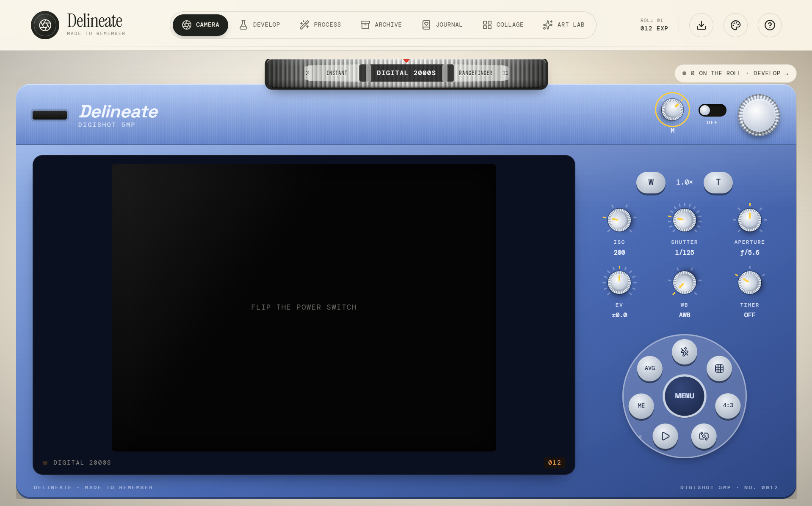
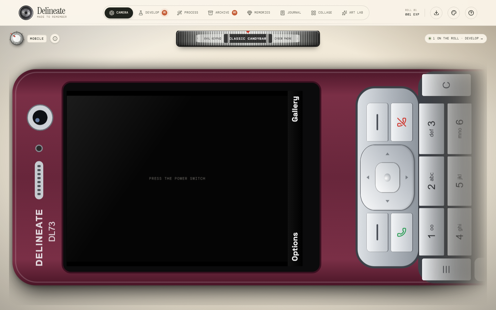
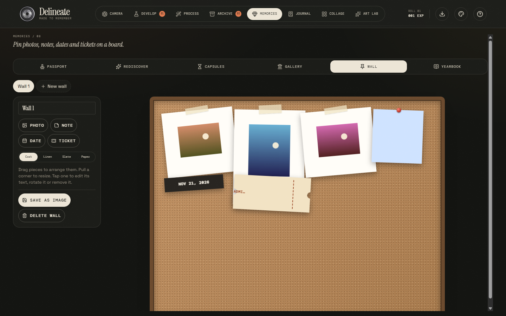

<p align="center">
  
</p>

<h1 align="center">Delineate</h1>
<p align="center"><em>Made to Remember.</em></p>

<p align="center">
  A film camera, darkroom, photo lab, scrapbook journal and collage studio — all in the browser.<br />
  Private by default, installable, and it works offline.
</p>



## What it does

| Tab | What you get |
| --- | --- |
| **Camera** | A physical-feeling camera with six bodies (Classic Film, Disposable, Instant, Digital 2000s, Rangefinder, Modern Minimal), each with its own layout, shutter animation, sounds and haptics. Real rotary knobs for ISO, shutter, aperture, EV, white balance and timer; auto / manual mode; zoom; grid; aspect ratios; front/back camera. Real long exposures and Bulb mode (averaged or light-trail), in-camera double/triple exposure, and the phone's LED flash where the browser supports it. |
| **Develop** | Every shot lands on the roll as a negative. Print it by hand in a first-person darkroom: expose under the enlarger, rock the developer, stop, fix, wash and hang it to dry — and get graded. Or let the one-hour lab skip it. |
| **Process** | Film, vintage, digital, nostalgia, editorial, cinematic and experimental presets (Portra, CineStill, VHS, CCD, Infrared, CRT…) plus 25+ effects: halation, mist, starburst, lens flare, light leaks, motion trails, cross-processing, bleach bypass, solarization, thermal, MiniDV, CRT, anamorphic, gate weave, date stamps, double exposure, film borders and 2×2 photo-booth strips. Settings are saved, so frames can be re-edited later. |
| **Archive** | Private storage with favourites, search, filters and six display modes (grid, compact, large, contact sheet, polaroid wall, list). Download one frame or the whole roll as a ZIP. |
| **Journal** | Scrapbook books with themed pages, photos, text, freehand doodles and 80+ decorations, ready-made page layouts, zoom and pinch, undo — exported as a PDF. |
| **Collage** | 13 layouts and 6 styles with adjustable spacing, margins, corners, borders, shadows and captions. |
| **Art Lab** | Turn a print into pixel art, abstract swirls, geometric facets or a looping GIF, with picture frames. |

Everything is customisable: five themes (Light, Dark, Vintage, Pastel, Darkroom), an accent colour, and three control styles — modern sliders, vintage tactile faders or rotary knobs.

## Privacy

Photos and journals are stored only in your browser (IndexedDB). Nothing is uploaded. Clearing site data erases the archive, so download anything you want to keep.

## Run it locally

Requires Node.js 20.19+ or 22.12+.

```bash
npm install
npm run dev       # development server
npm run build     # production build into dist/
npm run preview   # serve the production build
```

The camera needs a secure context: `localhost` works, anything else needs HTTPS.

## Deploy

`npm run build` produces a static site in `dist/`. Host it at the root of any HTTPS domain — for example drag `dist/` onto [Netlify Drop](https://app.netlify.com/drop), or import the repo into Vercel or Cloudflare Pages with build command `npm run build` and output directory `dist`.

After the first visit the app works offline, and phones can install it from the browser menu ("Add to Home screen" / "Install app").

## Tech

React 19, TypeScript and Vite. All image processing runs on the HTML canvas; no image or PDF libraries. `gifenc` encodes animated GIFs and `jszip` packs archive exports.

```
src/
  components/   one view per tab, plus shared UI (knobs, pickers, modals)
  lib/          rendering pipeline, effects, frames, PDF writer, storage, audio
  styles/       global theme and per-section styles
public/         icons, web manifest and the offline service worker
```

A small self-check for the PDF writer: `node scripts/pdf.check.ts` (Node 22.6+).

---

## What's new (1.1 – 1.3)



### Camera collection

The camera is now a collection of **30 bodies in five collections**, picked with a knurled rotary dial and the body wheel. Every body has its own layout, its own button and shutter sounds, and its own look that shows live in the viewfinder and is baked into the photo.

| Collection | Bodies (inspired by) |
| --- | --- |
| **Digi Cam** | The original six bodies |
| **Retro Mobile** | Nokia 6600, Nokia N73, Sony Ericsson K750i/W810i, Motorola RAZR V3 (drawn keypad phones, held sideways on wide screens) and iPhone 3GS |
| **Pocket Digital** | Canon IXUS, Sony Cyber-shot, Fujifilm FinePix, Nikon Coolpix, Casio Exilim, Olympus µ, Panasonic Lumix, Kodak EasyShare — each with its own button layout |
| **Film & Instant** | Instax Mini and Polaroid SX-70 (framed prints), Kodak FunSaver, Olympus Mju II, Diana F, Leica M6 — wind-on film where the real camera had it |
| **Experimental** | VHS and MiniDV camcorders (tape transport, timestamps), a four-shade pixel camera, an early desktop webcam, a panoramic film camera |

Playback on every body browses the whole gallery (W/T, arrows, tape rewind/fast-forward or a swipe), and each body has an on-screen settings menu. In **Process**, *Strip cam FX* removes a body's built-in look to edit the clean capture.

### Develop: advanced darkroom

Next to the hands-on darkroom there is an **Advanced** mode: exposure, highlights, shadows, whites, blacks, temperature, tint, vibrance, HSL, tone curves, split toning, bloom and halation — with undo/redo, before/after split, hold-to-compare, copy/paste of chosen adjustments and a **Recipe Lab** (starter looks, rename, duplicate, reorder, favourite, import/export as JSON). Edits are non-destructive: originals and edit settings are stored side by side.

### Memories


A new **Memories** tab gathers the signature experiences:

- **Passport** — a stamp for every camera you have shot with; tap one to pick that camera up again.
- **Rediscover** — opt-in *Forgotten Frames*: a random handful of five older, unfavourited photos each day (keep close, add to an album, or not now), plus *On This Day*. Nothing is ever deleted or uploaded.
- **Capsules** — seal photos and a note until a date you choose.
- **Gallery** — favourites, albums and each year hung on a lit gallery wall, with a slideshow.
- **Wall** — pin photos, notes, dates and ticket stubs on cork, linen, slate or paper; save the board as an image.
- **Yearbook** — a year of photos laid out by month, previewed and exported as a PDF.



### Archive, data and settings

- **Albums** in the Archive — add any frame to one or more albums.
- **Customise → Data** — see what is stored and how much space it uses, protect storage from being cleared, and download a full **backup (.zip)** that restores on any device. Restores are checked first and never delete anything.
- Customise has tabs (Look, Controls, Sound, Comfort, Data, What's new), more themes, button sound packs and clicky tactile sliders.
- Crop, straighten, highlights/shadows, sharpen, dust and scratches, saved presets, more frames and date stamps, journal cover photos and styles, and collage stickers, text and freely placed frames.

<p align="center">
  
</p>
