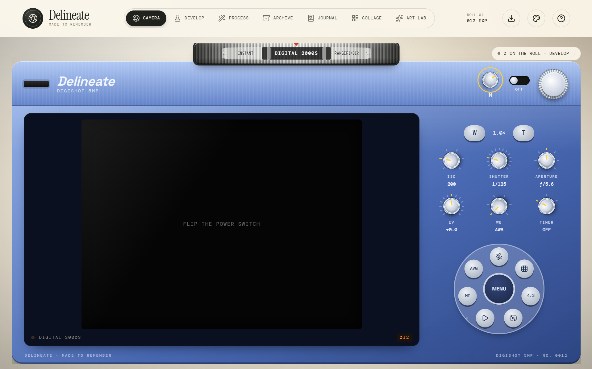

<p align="center">
  
</p>

<h1 align="center">Delineate</h1>
<p align="center"><em>Made to Remember.</em></p>

<p align="center">
  A film camera, darkroom, photo lab, scrapbook journal and collage studio — all in the browser.<br />
  Private by default, installable, and it works offline.
</p>



## What it does

| Tab | What you get |
| --- | --- |
| **Camera** | A physical-feeling camera with six bodies (Classic Film, Disposable, Instant, Digital 2000s, Rangefinder, Modern Minimal), each with its own layout, shutter animation, sounds and haptics. Real rotary knobs for ISO, shutter, aperture, EV, white balance and timer; auto / manual mode; zoom; grid; aspect ratios; front/back camera. Real long exposures and Bulb mode (averaged or light-trail), in-camera double/triple exposure, and the phone's LED flash where the browser supports it. |
| **Develop** | Every shot lands on the roll as a negative. Print it by hand in a first-person darkroom: expose under the enlarger, rock the developer, stop, fix, wash and hang it to dry — and get graded. Or let the one-hour lab skip it. |
| **Process** | Film, vintage, digital, nostalgia, editorial, cinematic and experimental presets (Portra, CineStill, VHS, CCD, Infrared, CRT…) plus 25+ effects: halation, mist, starburst, lens flare, light leaks, motion trails, cross-processing, bleach bypass, solarization, thermal, MiniDV, CRT, anamorphic, gate weave, date stamps, double exposure, film borders and 2×2 photo-booth strips. Settings are saved, so frames can be re-edited later. |
| **Archive** | Private storage with favourites, search, filters and six display modes (grid, compact, large, contact sheet, polaroid wall, list). Download one frame or the whole roll as a ZIP. |
| **Journal** | Scrapbook books with themed pages, photos, text, freehand doodles and 80+ decorations, ready-made page layouts, zoom and pinch, undo — exported as a PDF. |
| **Collage** | 13 layouts and 6 styles with adjustable spacing, margins, corners, borders, shadows and captions. |
| **Art Lab** | Turn a print into pixel art, abstract swirls, geometric facets or a looping GIF, with picture frames. |

Everything is customisable: five themes (Light, Dark, Vintage, Pastel, Darkroom), an accent colour, and three control styles — modern sliders, vintage tactile faders or rotary knobs.

## Privacy

Photos and journals are stored only in your browser (IndexedDB). Nothing is uploaded. Clearing site data erases the archive, so download anything you want to keep.

## Run it locally

Requires Node.js 20.19+ or 22.12+.

```bash
npm install
npm run dev       # development server
npm run build     # production build into dist/
npm run preview   # serve the production build
```

The camera needs a secure context: `localhost` works, anything else needs HTTPS.

## Deploy

`npm run build` produces a static site in `dist/`. Host it at the root of any HTTPS domain — for example drag `dist/` onto [Netlify Drop](https://app.netlify.com/drop), or import the repo into Vercel or Cloudflare Pages with build command `npm run build` and output directory `dist`.

After the first visit the app works offline, and phones can install it from the browser menu ("Add to Home screen" / "Install app").

## Tech

React 19, TypeScript and Vite. All image processing runs on the HTML canvas; no image or PDF libraries. `gifenc` encodes animated GIFs and `jszip` packs archive exports.

```
src/
  components/   one view per tab, plus shared UI (knobs, pickers, modals)
  lib/          rendering pipeline, effects, frames, PDF writer, storage, audio
  styles/       global theme and per-section styles
public/         icons, web manifest and the offline service worker
```

A small self-check for the PDF writer: `node scripts/pdf.check.ts` (Node 22.6+).
